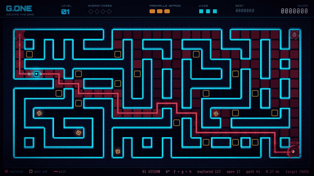

# G.ONE: Escape the Grid

A neon maze-chase game inspired by the film *Ra.One*, built with **Python** and **Pygame**.
You are G.One, trapped inside a digital city. Ra.One has escaped the game and hunts you
through the maze using **A\* search**. Collect every energy core, then reach the exit portal.

### ▶ [Play it in your browser](https://fahmidaca.github.io/G-One-Escape-the-Grid/), on a computer or a phone (turn the phone sideways)



## Features

- **Ra.One's A\* brain:** it plans a fresh shortest path to you every time it reaches a cell, so it goes around walls and through shortcuts.
- **AI Vision (press V):** watch A\* think live. You see the cells it explored, the open set, the path it chose, and the cell it is aiming for.
- **Compare search algorithms (press H):** switch Ra.One between A\*, Dijkstra and Greedy best-first and see the difference on screen.
- **Ra.One gets smarter:** from level 2 it predicts where you are heading and cuts you off. Each level it gets faster and the maze has fewer escape loops.
- **Firewalls (press SPACE):** drop a firewall behind you. Ra.One's A\* has to find a new route around it.
- **Neon look:** glowing walls, particles, screen shake, a CRT scanline filter, a danger pulse when Ra.One gets close, and a glitch effect when you are caught.
- **Sound effects made in code**, high score saving, pause menu and fullscreen.

## How to run

1. Install [Python 3.10 or newer](https://www.python.org/downloads/). On Windows, tick **"Add Python to PATH"** during setup.
2. Open a terminal in this folder and install Pygame:
   ```
   pip install pygame-ce
   ```
3. Start the game:
   ```
   python main.py
   ```

On Windows you can also double-click `run_windows.bat`, which does steps 2 and 3 for you.
The game also works with the classic `pygame` package.

## Controls

| Key | Action |
|---|---|
| Arrow keys / WASD | Move |
| Click / tap a spot | G.One runs there along the shortest route |
| G or the AUTO button | Auto-pilot: G.One plays by itself (keys and clicks still take over) |
| SPACE, right click or tap on G.One | Drop a firewall behind you (3 per level) |
| V | AI Vision on/off |
| H | Switch Ra.One's search: A\* / Dijkstra / Greedy |
| P or ESC | Pause |
| M | Mute |
| F11 | Fullscreen |

## How A\* works in this game

Ra.One treats the maze as a grid graph. Each move costs 1, and it can move up, down, left or right.
For every cell `n` it computes:

```
f(n) = g(n) + h(n)
g(n) = moves from Ra.One to n
h(n) = Manhattan distance from n to the target = |dx| + |dy|
```

It always expands the cell with the lowest `f` from the **open set** (a priority queue) and moves it to
the **closed set**. When it reaches the target, it follows the parent links back to get the path.
The Manhattan distance never overestimates on a 4-direction grid, so it is an **admissible heuristic**
and A\* always finds a shortest path.

Tested on 1,500 random searches in the game's own mazes:

| Search | Formula | Shortest path? | Average cells explored |
|---|---|---|---|
| A\* | f = g + h | Always | 52 |
| Dijkstra | f = g | Always | 113 |
| Greedy best-first | f = h | No: longer in 28% of searches | 36 |

A\* finds the same shortest path as Dijkstra while exploring about half as many cells. Run
`python astar.py` to see the three searches compared on a small text maze.

### Ra.One's behaviour by level

| Level | What changes |
|---|---|
| 1 | Chases your current cell with A\* |
| 2 | Predicts your route: aims 4 cells ahead of where you are heading |
| 3+ | Faster every level (up to 6.6 cells/s; you move at 7) and the maze has fewer loops |

## Project structure

```
main.py       game loop, screens, HUD, drawing, AI Vision
astar.py      A*, Dijkstra and Greedy search (runs on its own as a demo)
autopilot.py  G.One's auto-pilot: nearest core by BFS, runs from Ra.One using a danger map
entities.py   G.One (player) and Ra.One (the A* hunter)
world.py      maze generation (recursive backtracker), cores, portal, firewalls
effects.py    glow, particles, screen shake, CRT overlay, glitch, glowing text
sound.py      sound effects synthesised in code
settings.py   window size, colours, speeds and difficulty
assets/fonts  Orbitron and Share Tech Mono (SIL Open Font License)
```

## Ideas to extend it

- A turn-based "core duel" against Ra.One at the end of each level, using **minimax**.
- Weighted terrain (slow zones) so A\* has to balance distance against cost.
- Background music and more enemy types.
- A web version built with `pygbag`, so it can be played from a portfolio page.

## Credits

Made by **Fahmida Rahman**.
Fonts: [Orbitron](https://github.com/theleagueof/orbitron) and Share Tech Mono, both under the SIL Open Font License (see `assets/fonts`).
